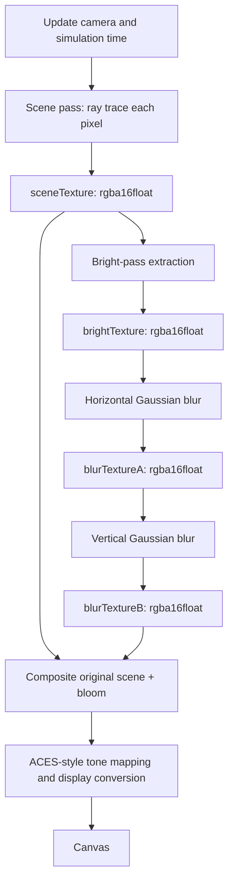

# WebGPU Black Hole Simulation

A real-time black hole visualization built with **WebGPU, TypeScript, and WGSL**. The project renders a non-rotating Schwarzschild black hole, traces light rays through curved spacetime, shades a procedural accretion disk, and applies an HDR post-processing pipeline with bloom.

The renderer is designed as a learning project: the implementation exposes the camera, ray integration, disk intersection, and post-processing stages rather than hiding them behind a rendering engine.

> **Project status:** Active development. Several visual effects are approximations intended for real-time visualization, not a complete general-relativistic radiative-transfer simulation. See [Current limitations](#current-limitations).

## Features

- **WebGPU renderer:** TypeScript application with WGSL vertex and fragment shaders.
- **Fullscreen rendering:** A fullscreen triangle is used for per-pixel ray generation and shading.
- **Camera system:** Free-fly camera with mouse look, keyboard movement, and frame-time-based motion.
- **Schwarzschild ray tracing:** Light-ray trajectories are integrated in the orbital plane using the Schwarzschild null-orbit equation and fourth-order Runge–Kutta (RK4) integration.
- **Event-horizon capture:** Rays that reach the Schwarzschild radius are classified as captured.
- **Accretion disk:** A thin disk in the XZ plane, intersected by the integrated ray trajectory and shaded with procedural turbulence.
- **Animated disk texture:** Procedural structures rotate with an approximate Keplerian differential angular velocity; the inner disk rotates faster than the outer disk.
- **Photon-ring highlight:** A preliminary highlight uses the critical impact parameter and accumulated orbital angle as a heuristic for strongly lensed disk rays.
- **Procedural starfield:** Escaping rays sample a procedural spherical starfield using an estimated outgoing ray direction.
- **HDR and bloom:** The scene is rendered to an `rgba16float` texture, bright regions are extracted, blurred horizontally and vertically, then composited with the original scene.
- **Tone mapping:** The final composite uses an ACES-style tone-mapping curve and a display gamma conversion.

## Technology

- TypeScript
- [Vite](https://vite.dev/) for the development server and build
- WebGPU for rendering
- WGSL for GPU shaders
- Floating-point HDR render targets (`rgba16float`)

A browser with WebGPU support and a compatible GPU/driver is required.

## Getting started

### 1. Install dependencies

From the project root, install the dependencies declared in `package.json`:

```powershell
npm.cmd install
```

On Windows PowerShell, use `npm.cmd` if the `npm` command is blocked by the PowerShell execution policy.

### 2. Start the development server

```powershell
npm.cmd run dev
```

Open the local URL printed by Vite in a WebGPU-capable browser.

### 3. Build the project

```powershell
npm.cmd run build
```

The production build is written to Vite's `dist/` directory.

## Controls

Click inside the canvas to capture the mouse. Press `Escape` to release it.

| Input | Action |
|---|---|
| Mouse movement | Look around |
| `W` / `S` | Move forward / backward |
| `A` / `D` | Strafe left / right |
| `E` / `Q` | Move up / down |
| `Shift` | Move faster |
| `Escape` | Release pointer lock |

Movement is updated using frame delta time so that camera speed is not directly tied to the frame rate. The camera movement code also keeps the camera outside a safety radius around the event horizon, since the current orbit initialization assumes an observer outside the horizon.

## Project layout

The source files are organized around one scene shader and three post-processing shaders. Exact folders may differ depending on the Vite project layout.

```text
project/
├── index.html
├── package.json
├── tsconfig*.json
└── src/
    ├── main.ts            # WebGPU setup, resources, camera, render loop
    ├── shaders.wgsl       # Scene rendering, ray tracing, disk, starfield
    ├── brightpass.wgsl    # HDR bright-region extraction
    ├── blur.wgsl          # Separable Gaussian blur
    └── composite.wgsl     # Scene + bloom composition and tone mapping
```

If the `.ts` and `.wgsl` files are currently in the project root rather than `src/`, keep the imports consistent with their actual locations.

## Rendering architecture

The application records and submits a sequence of render passes each frame. The fullscreen triangle is drawn again for each pass, but each pass runs a different shader operation and writes to a different texture.



### Render passes

1. **Scene pass:** Generates a camera ray for each pixel, traces it around the black hole, and shades either the event-horizon shadow, accretion disk, or background.
2. **Bright-pass:** Reads the HDR scene and extracts pixels above a luminance/brightness threshold.
3. **Horizontal blur:** Applies a one-dimensional Gaussian-like kernel horizontally to the bright texture.
4. **Vertical blur:** Applies the same kernel vertically to the horizontal result. Two one-dimensional passes approximate a two-dimensional Gaussian blur at lower cost.
5. **Composite:** Adds the blurred highlights to the original HDR scene, applies tone mapping, and writes the result to the canvas.

The scene and post-processing textures use `rgba16float` so intermediate HDR values can be preserved. The canvas uses the browser's preferred canvas format.

## Black hole and ray-tracing model

The current scene uses a **Schwarzschild black hole**, which is the idealized, non-rotating solution. The event-horizon radius is denoted by \(r_s\).

For null geodesics in the orbital plane, the shader uses

\[
 u = \frac{1}{r}, \qquad
 \frac{d^2u}{d\phi^2} = -u + \frac{3}{2}r_su^2.
\]

The pair \((u, du/d\phi)\) is integrated with RK4. The ray's orbital plane is reconstructed from its initial radial and tangential basis vectors. The impact parameter is calculated from the initial local ray direction and the Schwarzschild metric factor.

The photon sphere and critical impact parameter for a Schwarzschild black hole are

\[
 r_{\mathrm{ph}} = \frac{3}{2}r_s,
 \qquad
 b_{\mathrm{crit}} = \frac{3\sqrt{3}}{2}r_s.
\]

The critical impact parameter is currently used as part of a **visual heuristic** for highlighting strongly lensed disk rays. It is not yet a complete calculation of photon-ring subimages.

### Current scene parameters

The shader currently uses these default values; change them in `shaders.wgsl` to experiment.

| Parameter | Current value | Meaning |
|---|---:|---|
| Black-hole center | `(0, 0, -5)` | World-space center |
| Schwarzschild radius | `0.65` | Event-horizon radius in scene units |
| Disk inner radius | `0.85` | Inner edge of the thin disk |
| Disk outer radius | `2.2` | Outer edge of the thin disk |
| RK4 step size | `0.01` | Integration step in orbital angle |
| Maximum integration steps | `1000` | Upper bound on ray integration work |
| Escape radius | `100` | Radius at which an outward ray is treated as escaped |

The accretion disk lies in the XZ plane, centered on the black hole's XZ coordinates; its plane is `y = blackHoleCenter.y`.

## Accretion disk animation

The disk's turbulent pattern is generated from procedural hash-based value noise. The shader samples the noise using an animated angular coordinate:

\[
 \theta_{\mathrm{animated}} = \theta - \omega(r)t.
\]

The angular velocity uses an approximate Keplerian profile in geometrized units:

\[
 \omega(r) \approx \sqrt{\frac{r_s}{2r^3}}.
\]

This creates differential rotation: material closer to the black hole moves faster than material farther away. The animation is a moving procedural texture, not a hydrodynamic simulation of gas.

Simulation time is passed through the `cameraRotation.z` component of the camera uniform. The TypeScript render loop writes the elapsed time in seconds each frame.

## Camera system

The camera uniform contains three `vec4f` values (48 bytes total):

- `resolutionFov`: viewport width, viewport height, tangent of half the vertical field of view, padding.
- `cameraPosition`: world-space camera position, padding.
- `cameraRotation`: yaw, pitch, elapsed simulation time, padding.

The free-fly camera is updated in TypeScript and uploaded to the GPU once per frame. The WGSL shader uses yaw and pitch to construct a camera basis and generate a ray for each fullscreen-triangle fragment.

## Post-processing and bloom

Bloom is implemented as a multi-pass HDR effect:

- Bright-pass extraction isolates luminous pixels.
- A horizontal blur pass spreads highlights sideways.
- A vertical blur pass spreads the result vertically.
- The composite pass adds the blurred highlights to the original scene.
- An ACES-style curve compresses HDR values for display, followed by a gamma conversion.

The current implementation blurs at the full scene resolution. A half- or quarter-resolution bloom chain is a planned optimization, especially for lower-powered GPUs.

## Current limitations

This project is a real-time visualization and learning renderer. The following limitations are important when interpreting its output:

- **Non-rotating black hole:** The model is Schwarzschild, not Kerr. It does not simulate spin or frame dragging.
- **Thin, static disk geometry:** The disk is an idealized plane. There is no gas dynamics, pressure, magnetic field, viscosity, or self-shadowing simulation.
- **Approximate disk motion:** The procedural pattern rotates using a Keplerian-style angular-velocity approximation. It is not a fluid simulation, and the shading does not yet calculate full relativistic Doppler beaming or gravitational redshift.
- **Approximate disk intersections:** The ray is integrated in fixed angular steps, and a disk-plane crossing is estimated by linear interpolation between adjacent samples. Only the first valid disk intersection is returned, so later crossings and complete higher-order disk images are not yet represented.
- **Approximate photon-ring effect:** The current ring highlight combines proximity to the critical impact parameter with accumulated path angle for rays that hit the disk. It is a visual approximation, not a resolved, physically complete photon ring.
- **Approximate background direction:** Escaping rays are stopped at a finite radius (currently 100 scene units), and their outgoing direction is estimated there. This is not an exact integration to an observer at infinity.
- **Procedural starfield:** Stars are generated from spherical directional coordinates and hash functions. The field is not an astronomical catalogue or a detailed Milky Way model.
- **Performance:** The ray tracer can perform up to 1000 RK4 steps per pixel. The full-resolution post-processing passes add further GPU work. Performance depends heavily on the browser, GPU, driver, and canvas resolution.

## Development roadmap

Potential next improvements include:

- More accurate asymptotic outgoing-ray directions and background lensing.
- Multiple accretion-disk crossings and higher-order lensed images.
- A more physically grounded photon-ring implementation.
- Relativistic Doppler beaming and gravitational redshift for disk shading.
- More detailed procedural turbulence and disk structure.
- Downsampled bloom textures and other GPU performance optimizations.
- Camera orbit mode, zoom, and improved camera controls.
- Optional rotating (Kerr) black-hole model as a separate, more advanced extension.

## Troubleshooting

### WebGPU is unavailable

Use a browser and GPU/driver combination that supports WebGPU. Check `navigator.gpu` and the browser's GPU diagnostics if `requestAdapter()` returns `null`.

### WGSL compilation errors

The application logs shader compilation messages for the scene, bright-pass, blur, and composite modules. Check the reported WGSL line and column. WGSL identifiers are case-sensitive, and variables declared inside a block cannot be referenced outside that block.

### PowerShell does not run `npm`

Use the Windows command shim:

```powershell
npm.cmd run dev
npm.cmd run build
```

### Low frame rate

The scene ray tracer is the most expensive stage. Try reducing the canvas's effective resolution while debugging, then consider reducing integration work or rendering bloom at a lower resolution. Do not reduce the RK4 step size or maximum step count without checking the resulting ray paths for visible inaccuracies.

## License

No license is specified in this README. Add a `LICENSE` file before distributing the project if you want to grant others explicit reuse rights.
